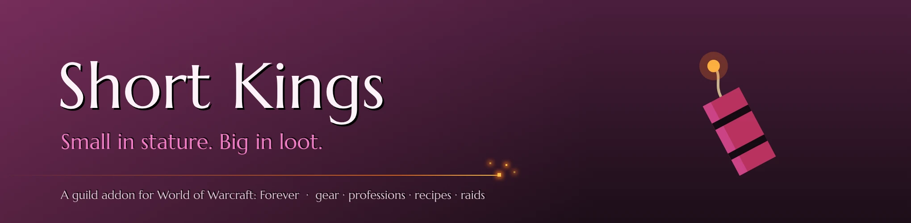
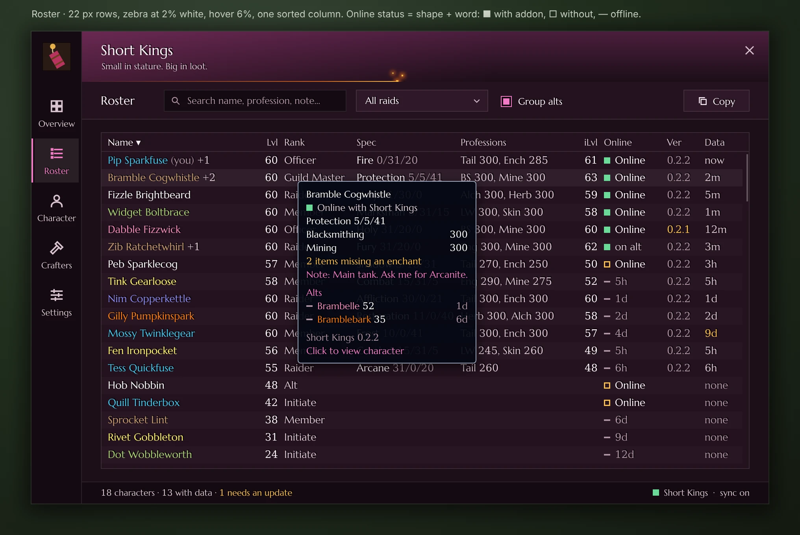
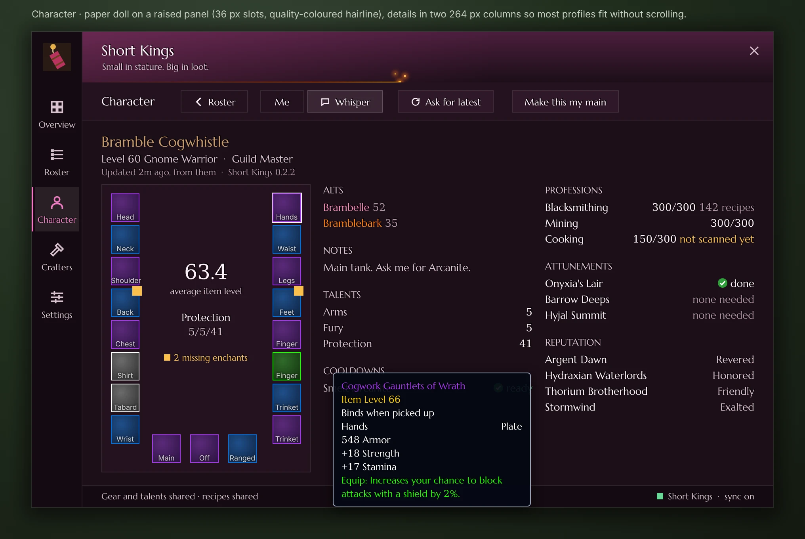
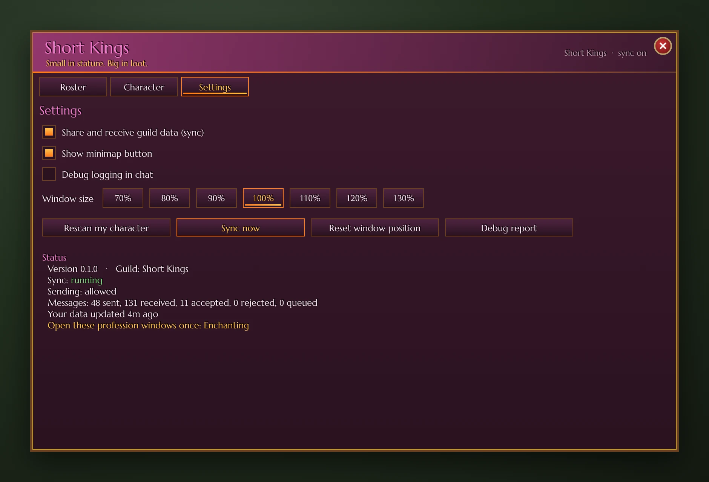
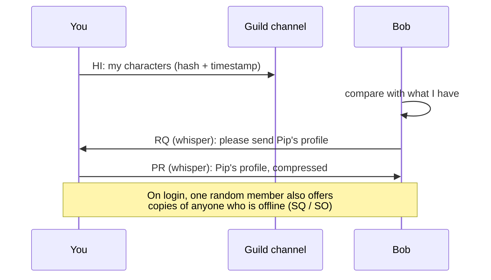

<p align="center">
  
</p>

<p align="center">
  <a href="https://github.com/EllisKOsborn/forever-shortkings/actions/workflows/ci.yml"></a>
  
  
  
</p>

<p align="center">
  <b>The guild addon for the Short Kings of World of Warcraft: Forever.</b><br>
  See every member's gear, talents, professions and recipes in one window.<br>
  No website, no server, no uploads: it all travels over the guild's addon channel.
</p>

<p align="center">
  <a href="#install">Install</a> ·
  <a href="#whats-inside">What's inside</a> ·
  <a href="#commands">Commands</a> ·
  <a href="#faq">FAQ</a> ·
  <a href="#roadmap">Roadmap</a>
</p>

> [!NOTE]
> **v0.1 is an alpha that hasn't been run in game yet.** It's built against
> Blizzard's own Forever 1.60.1 interface code and tested with a simulated WoW
> client. The pictures below are **mockups** drawn from the addon's real
> colours and layout. Item icons are placeholders; in game you see the real ones.

---

<a id="whats-inside"></a>

## 🧨 What's inside

### Roster
Every guild member at a glance: class colours, level, rank, talent spec,
professions, item level and when they were last online. Click a column to
sort, type to search ("tailoring", "holy", a name…) and hover for details.

<p align="center"></p>

### Character
A paperdoll for anyone in the guild. Hover a slot for the **real item
tooltip**, or Shift-click it to link it in chat. Alongside it: talents,
profession levels and recipe counts, cooldowns (transmutes and the like),
attunements and reputations.

<p align="center"></p>

### Settings
Turn sync on or off, hide the minimap button, change the window size, and see
exactly what the addon is doing.

<details>
<summary>Show the Settings tab</summary>
<p align="center"></p>
</details>

### Under the hood
- **Your own data always wins.** A copy passed on by someone else can never overwrite a newer copy from the character themselves.
- **Light on the network.** Only small fingerprints are broadcast, and full profiles are whispered to whoever needs them. Everything is rate-limited, so nobody gets disconnected.
- **Stays out of your way.** Sync pauses in combat, in dungeons, raids, battlegrounds and arenas, and whenever the game locks addon chat.
- **Tidies up.** Members who leave the guild are forgotten 30 days later.

---

<a id="install"></a>

## 📦 Install

1. Download the latest **`ShortKings-x.y.z.zip`** from
   [**Releases**](https://github.com/EllisKOsborn/forever-shortkings/releases).
2. Unzip it. You'll get a folder called **`ShortKings`**.
3. Move that folder into your Forever **AddOns** folder:

   🍎 **Mac**
   ```
   /Applications/World of Warcraft/_forever_/Interface/AddOns/
   ```
   🪟 **Windows**
   ```
   C:\Program Files (x86)\World of Warcraft\_forever_\Interface\AddOns\
   ```

4. Restart the game. *Short Kings* should be listed under **AddOns** on the character screen.

> [!TIP]
> **Can't find the folder?** In the Battle.net app, pick **WoW Forever**,
> click the **⚙** next to Play, then **Show in Explorer** (Windows) or
> **Show in Finder** (Mac). Open `Interface`, then `AddOns`. If there's no
> `AddOns` folder, create one, spelled exactly like that.

> [!IMPORTANT]
> The result must be `AddOns/ShortKings/ShortKings.toc`. A `ShortKings`
> folder inside another `ShortKings` folder won't load.

**First time in game:**
- Open each of your **profession windows once** so your recipes are recorded. The addon reminds you which ones are left.
- Log in on each **alt** once, too.

---

<a id="commands"></a>

## ⌨️ Commands

| Type this | To |
|---|---|
| `/sk` | open or close the window (the minimap button does the same) |
| `/sk debug` | get a copyable report of what the addon can see. **Send this when something's wrong** |
| `/sk log` | get the same report plus the recent log |
| `/sk scan` | re-read your character right now |
| `/sk sync` | share your data now and ask for anything missing |
| `/sk reset` | put the window back in the middle of the screen |

`/shortkings` works too, if another addon already uses `/sk`.

---

<a id="faq"></a>

## ❓ FAQ

<details>
<summary><b>Someone shows "no addon/trial". Why?</b></summary>

They don't have Short Kings installed, haven't logged in since installing it,
or are on a **trial account**. Trial accounts can't send addon messages, so
their data can't reach anyone. From the outside, the addon can't tell these
cases apart.
</details>

<details>
<summary><b>My alt is missing.</b></summary>

The game only lets an addon read the character you're logged in as. Log in on
the alt once and it will be saved and shared.
</details>

<details>
<summary><b>My recipes aren't showing.</b></summary>

Open that profession's window once. Recipes are read from the profession
window, so the Character tab says "not scanned yet" until you do.
</details>

<details>
<summary><b>It says "out of date" on the AddOns screen.</b></summary>

Tick **Load out of date AddOns** for now, and tell an officer. The addon
needs a new interface number for the latest game patch.
</details>

<details>
<summary><b>Will it get me disconnected or slow my game down?</b></summary>

It shouldn't. Messages are small, compressed and rate-limited through
ChatThrottleLib, and nothing is sent during combat or inside instances.
Recipe scans are spread over several frames.
</details>

<details>
<summary><b>How does syncing actually work?</b></summary>



The full design, data format and merge rules are in [PLAN.md](PLAN.md).
</details>

---

<a id="roadmap"></a>

## 🗺️ Roadmap

- [x] **v0.1**: data collection, guild sync, Roster, Character and Settings tabs, `/sk debug`
- [ ] **v0.1.x**: online/addon status dots, alts under mains, roster notes, version column, missing-enchant markers, privacy toggle
- [ ] **v0.2**: **Crafters** (search an item, see who can make it, Whisper) and **Professions** (coverage, cooldown board, recipes nobody has), plus "Crafted by" on item tooltips
- [ ] **v0.3**: **Raids**, built on Blizzard's guild calendar: sign-up status, roles, line-up with attunement check, reminders, invite-all
- [ ] **v0.4**: theme polish (ember sparks on the title bar), attunement and faction tables confirmed for Forever
- [ ] **Later**: craft requests, raid attendance, export to text. See the [feature review](docs/FEATURE-REVIEW.md)
- [ ] CurseForge release

Testing it in game? Work through the checklist in [TESTING.md](TESTING.md).

---

<details>
<summary><b>🛠️ For developers</b></summary>

```sh
luacheck .    # lint
busted        # unit tests: Lua 5.1, stubbed WoW API in tests/helpers/
node docs/mockups/render.js [font.woff2]   # regenerate the README pictures
```

| Folder | What lives there |
|---|---|
| `Core/` | start-up, events, saved data, guild roster; `Compat.lua` is the **only** file that touches client-specific APIs |
| `Collect/` | reads gear, talents, professions, recipes, reputation and attunements |
| `Sync/` | encoding (LibSerialize + LibDeflate), merge rules, the HI/RQ/PR/SQ/SO protocol |
| `UI/` | theme, widgets and tabs (colours and gradients only, no image files) |
| `Data/` | profession, attunement and faction tables (IDs are verified or marked TODO, never guessed) |

**Releasing:** push a tag like `v0.1.0`. The *Release* workflow runs the
BigWigs packager, which builds `ShortKings-0.1.0.zip` and attaches it to a
GitHub Release. For CurseForge, add a `CF_API_KEY` repository secret and an
`## X-Curse-Project-ID:` line to `ShortKings.toc`. Every push also produces
an unpublished **test build** (Actions → Tests → `ShortKings-test-build`).

**Theme palette** (from `UI/Theme.lua`):

| Plum dark | Plum | Magenta | Hot pink | Ember | Flame | Leather | Gold |
|---|---|---|---|---|---|---|---|
| `#2A1220` | `#3D1A2E` | `#D94FA0` | `#F07ACB` | `#FF7A1A` | `#FFC24A` | `#6B3E1E` | `#D4AF37` |
</details>

## 🙏 Credits

No code was copied from other guild-sync addons. API facts come from
[warcraft.wiki.gg](https://warcraft.wiki.gg/wiki/Patch_1.60.1/API_changes),
Blizzard's own UI source (mirrored at
[Gethe/wow-ui-source](https://github.com/Gethe/wow-ui-source), `forever`
branch), and public notes in the
[Everloot](https://github.com/Everloot/everloot/pull/49) and
[bff-wow](https://github.com/Shtian/bff-wow/issues/3) projects.

Libraries: Ace3 (AceComm, CallbackHandler, LibStub, ChatThrottleLib),
[LibSerialize](https://github.com/rossnichols/LibSerialize) by Ross Nichols,
[LibDeflate](https://github.com/SafeteeWoW/LibDeflate) by Haoqian He,
LibDataBroker and LibDBIcon. Licences are listed in [Libs/README.md](Libs/README.md).
The README mockups use [Marcellus](https://fonts.google.com/specimen/Marcellus)
(SIL OFL) as a stand-in for the game's font.

Released under the [MIT licence](LICENSE). Made with 💖 and 🧨 by the Short Kings.
